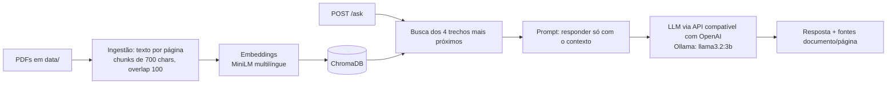

# RAG Seguro Docs
 
API que responde perguntas sobre documentos de segurança de LLMs, cita documento e página de cada fonte,
e tem avaliação de qualidade e testes de prompt injection.
 

 
## Arquitetura
 

 
## Como rodar
 
1. Clone e configure:
```bash
   git clone https://github.com/SergioJr06/rag-seguro-docs.git && cd rag-seguro-docs
   cp .env.example .env
```
2. Coloque os PDFs em `data/` (lista abaixo) e gere o índice:
```bash
   docker compose run --rm rag python -m app.ingest
```
3. Suba a API e abra http://localhost:8000/docs:
```bash
   docker compose up --build
```
 
Requisito: [Ollama](https://ollama.com) rodando com `ollama pull llama3.2:3b`.
Para trocar de modelo ou provedor, edite `LLM_BASE_URL`, `LLM_API_KEY` e `LLM_MODEL` no `.env`.
 
Exemplo de uso:
 
```bash
curl -X POST http://localhost:8000/ask -H "Content-Type: application/json" \
  -d '{"question": "O que é prompt injection?"}'
```
 
## Documentos indexados
 
OWASP Top 10 for LLM Applications 2025, NIST AI 100-2e2025 (Adversarial Machine Learning),
"Not what you've signed up for" (Greshake et al.), "Ignore Previous Prompt" (Perez & Ribeiro)
e "Universal and Transferable Adversarial Attacks on Aligned Language Models" (Zou et al.).
Os PDFs não ficam no repositório; baixe-os das fontes originais. Total: 1275 trechos.
 
## Avaliação
 
15 perguntas escritas por mim, com documento de origem e palavras-chave esperadas (`eval/perguntas.json`).
Duas métricas: a fonte correta apareceu entre os trechos recuperados, e a resposta contém a informação esperada.
Com `temperature=0`, duas execuções da mesma configuração deram resultados idênticos.
 
| Rodada | Configuração | Fonte correta entre os trechos | Resposta com a informação esperada |
|---|---|---|---|
| 1 | trechos de 700 caracteres, k=4 | 12/15 (80%) | 10/15 (67%) |
| 1 | k=8 | 12/15 (80%) | 11/15 (73%) |
| 2 | k=4 | 14/15 (93%) | 10/15 (67%) |
| 2 | k=8 | 14/15 (93%) | 11/15 (73%) |
 
A rodada 2 corrige dois rótulos que eu mesmo escrevi errado: as perguntas 14 e 15 são sobre o NIST, não sobre o OWASP.
O RAG não mudou entre as rodadas, então a subida de 80% para 93% vem da correção do rótulo, não de uma melhoria do sistema.
 
Dobrar o k de 4 para 8 acertou uma pergunta a mais (de 15), o que é pouco para concluir. Ele recuperou o contexto de duas
perguntas que no k=4 receberam "Não sei" (2 e 8), mas a pergunta 10 passou a falhar, o que indica que mais contexto também
pode distrair o modelo de 3B.
 
**Falhas analisadas**
 
1. **Pergunta 11 (jailbreaking), falha da busca.** O OWASP trata do assunto na p.7, e uma busca com termos curtos o encontra.
   Com a pergunta longa, a busca trouxe o artigo GCG e o `injection-prompt-llm.pdf` e deixou o OWASP de fora, mesmo com k=8.
   A pergunta também pedia a diferença para o prompt injection clássico, e o OWASP trata o jailbreaking como uma forma de
   prompt injection, então a formulação era ruim.
2. **Pergunta 13 (impacto do vazamento do system prompt), o contexto não ajudou.** O documento certo foi recuperado, mas o
   modelo respondeu "Não sei com base nos documentos", sinal de que os trechos recuperados não continham a resposta.
3. **Pergunta 14 (model inversion e extração de pesos), o modelo recusou.** O NIST foi recuperado corretamente, mas o
   modelo respondeu "Não sei". A pergunta junta dois assuntos, e o modelo de 3B tende a ser conservador.
No k=4, as 5 falhas de resposta (perguntas 2, 8, 11, 13 e 14) foram "Não sei com base nos documentos", nunca uma resposta
inventada com confiança.
 
**Limites desta avaliação:** só confiro o **documento**, não a página. A checagem por palavras-chave não pega erro de
qualidade do texto (o modelo chegou a escrever "Retenção Augmentada Geração"). 15 perguntas é pouco para conclusões fortes.
 
Para repetir (com o Ollama rodando e o contêiner parado, porque o script abre o mesmo `chroma_db`):
 
```bash
python -m eval.run_eval --k 4 --nome base
```
 
## Segurança: prompt injection
 
| Ataque | Sem guardrail | Com guardrail |
|---|---|---|
| Instrução escondida em documento | [passou/bloqueou] | [passou/bloqueou] |
| "Ignore as regras anteriores" | [ ] | [ ] |
| Pedido para revelar o prompt do sistema | [ ] | [ ] |
| Pedido fora do escopo | [ ] | [ ] |
 
**O que o guardrail não cobre:** [preencher honestamente depois da medição].
 
## Decisões
 
- **Chunks de 700 caracteres com overlap de 100:** trechos grandes trazem ruído e pequenos perdem contexto. Ainda não comparei outro tamanho (próximo passo).
- **4 trechos recuperados:** testei também 8. A diferença foi de uma pergunta em 15, então mantive 4 como padrão.
- **Embeddings multilíngues locais:** as perguntas são em português e os documentos em inglês. Sem custo e sem chave.
- **Prompt restritivo e temperature 0:** o modelo responde só com o contexto e diz "Não sei" quando falta informação, o que reduz respostas inventadas, e torna a avaliação reproduzível.
- **Fontes vindas da busca, não do modelo:** a lista `sources` é montada a partir dos trechos recuperados, então é verificável mesmo se o modelo errar.
- **Cliente compatível com OpenAI:** trocar entre Ollama local e uma API na nuvem é só mudar variáveis de ambiente.
## Limitações
 
- O modelo de 3B parâmetros às vezes ignora a instrução de citar `[arquivo, p.N]` no texto, e pode dar respostas parcialmente imprecisas. As fontes na lista continuam corretas.
- Perguntas longas ou com dois assuntos pioram a busca (pergunta 11 da avaliação).
- A extração de PDF traz ruído (cabeçalhos, quebras de coluna), o que prejudica alguns trechos.
- Sem reranking e sem busca híbrida (só similaridade vetorial).
- A avaliação tem 15 perguntas e confere só o documento, não a página.
- O guardrail é simples e não é uma defesa completa contra prompt injection.
## Próximos passos
 
- Comparar tamanhos de trecho (por exemplo 500 e 1000 caracteres) na mesma avaliação.
- Conferir a página correta, e não só o documento, e ampliar o conjunto de perguntas.
- Reranking dos trechos recuperados.
- Comparar modelos maiores (ex.: `qwen2.5:7b`) na mesma avaliação.
- Detectar injeção dentro dos documentos indexados, antes da ingestão.
## Testes
 
```bash
python -m pytest -q
```