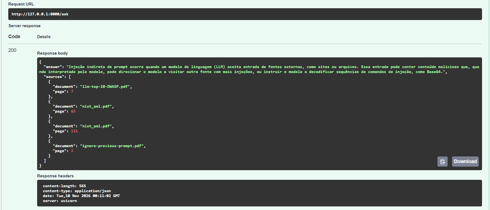
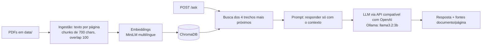

# RAG Seguro Docs

API que responde perguntas sobre documentos de segurança de LLMs, cita documento e página de cada fonte,
e tem avaliação de qualidade e testes de prompt injection.



## Arquitetura



## Como rodar

1. Clone e configure:
   ```bash
   git clone https://github.com/SEU_USUARIO/rag-seguro-docs.git && cd rag-seguro-docs
   cp .env.example .env
   ```
2. Coloque os PDFs em `data/` (lista abaixo) e gere o índice:
   ```bash
   docker compose run --rm rag python -m app.ingest
   ```
3. Suba a API e abra http://localhost:8000/docs:
   ```bash
   docker compose up --build
   ```

Requisito: [Ollama](https://ollama.com) rodando com `ollama pull llama3.2:3b`.
Para trocar de modelo ou provedor, edite `LLM_BASE_URL`, `LLM_API_KEY` e `LLM_MODEL` no `.env`.

Exemplo de uso:

```bash
curl -X POST http://localhost:8000/ask -H "Content-Type: application/json" \
  -d '{"question": "O que é prompt injection?"}'
```

## Documentos indexados

OWASP Top 10 for LLM Applications 2025, NIST AI 100-2e2025 (Adversarial Machine Learning),
"Not what you've signed up for" (Greshake et al.), "Ignore Previous Prompt" (Perez & Ribeiro)
e "Universal and Transferable Adversarial Attacks on Aligned Language Models" (Zou et al.).
Os PDFs não ficam no repositório; baixe-os das fontes originais. Total: 1275 trechos.

## Avaliação

[N] perguntas escritas por mim, com resposta esperada e documento de origem (`eval/`).

| Configuração | Fonte correta entre os trechos | Resposta com a informação esperada |
|---|---|---|
| Base (chunk 700, k=4) | [X]% | [Y]% |
| Depois de [melhoria] | [X2]% | [Y2]% |

Falhas analisadas: [3 falhas com a causa provável].

## Segurança: prompt injection

| Ataque | Sem guardrail | Com guardrail |
|---|---|---|
| Instrução escondida em documento | [passou/bloqueou] | [passou/bloqueou] |
| "Ignore as regras anteriores" | [ ] | [ ] |
| Pedido para revelar o prompt do sistema | [ ] | [ ] |
| Pedido fora do escopo | [ ] | [ ] |

**O que o guardrail não cobre:** [preencher honestamente na quinta].

## Decisões

- **Chunks de 700 caracteres com overlap de 100:** trechos grandes trazem ruído e pequenos perdem contexto. [Resultado do teste com outro valor.]
- **4 trechos recuperados:** [comparação com 2 e 6.]
- **Embeddings multilíngues locais:** as perguntas são em português e os documentos em inglês. Sem custo e sem chave.
- **Prompt restritivo e temperature 0:** o modelo responde só com o contexto e diz "Não sei" quando falta informação, o que reduz respostas inventadas.
- **Fontes vindas da busca, não do modelo:** a lista `sources` é montada a partir dos trechos recuperados, então é verificável mesmo se o modelo errar.
- **Cliente compatível com OpenAI:** trocar entre Ollama local e uma API na nuvem é só mudar variáveis de ambiente.

## Limitações

- O modelo de 3B parâmetros às vezes ignora a instrução de citar `[arquivo, p.N]` no texto, e pode dar respostas parcialmente imprecisas. As fontes na lista continuam corretas.
- A extração de PDF traz ruído (cabeçalhos, quebras de coluna), o que prejudica alguns trechos.
- Sem reranking e sem busca híbrida (só similaridade vetorial).
- O guardrail é simples e não é uma defesa completa contra prompt injection.

## Próximos passos

- Reranking dos trechos recuperados.
- Comparar modelos maiores (ex.: `qwen2.5:7b`) na mesma avaliação.
- Detectar injeção dentro dos documentos indexados, antes da ingestão.

## Testes

```bash
python -m pytest -q
```